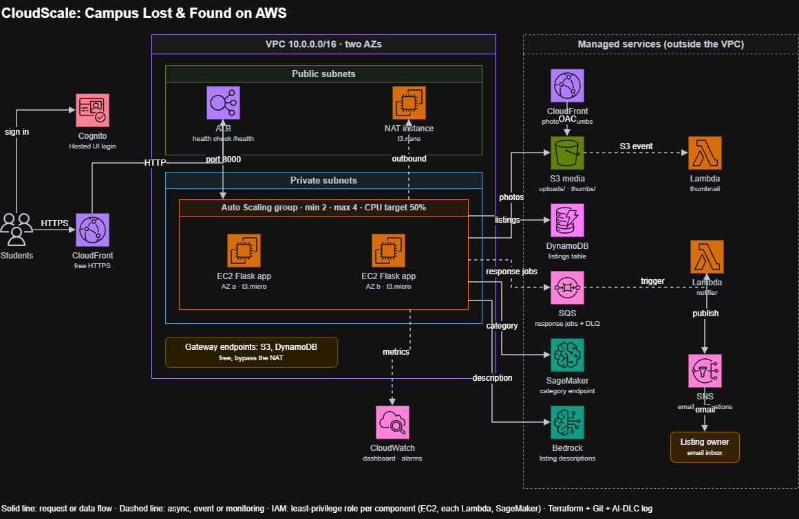

# CloudScale: Campus Lost & Found on AWS

**Course:** CS-4075 Cloud Computing  
**Authors:** Adnan Ahmed & Huzaifa Tahir  
**GitHub Repository:** [https://github.com/Adnan75500/cloudscale-cs4075](https://github.com/Adnan75500/cloudscale-cs4075)  
**Live Application URL:** [https://d2cxf1oeapulob.cloudfront.net](https://d2cxf1oeapulob.cloudfront.net)  
**Project Reports:**
- [PDF Report](docs/CloudScale_Project_Report.pdf)
- [Markdown Report](docs/CloudScale_Project_Report.md)

## Project Description

CloudScale is an enterprise-grade, multi-tier web platform built for campus lost-and-found operations. Built on AWS using Terraform infrastructure-as-code, it features automated horizontal scaling, serverless media processing, asynchronous email notifications, custom SageMaker machine learning classification, and Amazon Bedrock generative AI text assistance.

## Architecture



### Key Architecture Components:
- **Edge & Compute:** Amazon CloudFront HTTPS distribution routing to an Application Load Balancer across two public subnets, serving an Auto Scaling Group (2–4 instances, `t3.micro`) in private subnets.
- **Storage & CDN:** Private S3 media bucket with lifecycle tiers (Standard-IA after 30d, expiration after 90d) delivered via CloudFront with Origin Access Control (OAC).
- **Database:** DynamoDB on-demand table accessed securely via a private VPC Gateway Endpoint.
- **Identity:** Amazon Cognito Hosted UI using OAuth 2.0 Authorization Code flow.
- **Event-Driven Serverless:** S3-triggered thumbnail Lambda (Pillow layer) and SQS response queue with DLQ driving SNS notification emails.
- **Machine Learning & Generative AI:** SageMaker Serverless Inference Endpoint (`cloudscale-category`) for category prediction and Amazon Bedrock (`amazon.nova-lite-v1:0`) for AI listing description drafting.

## Technology Stack

- **Cloud Provider:** Amazon Web Services (AWS `us-east-1`)
- **IaC:** HashiCorp Terraform (v1.6+)
- **Backend:** Python 3.11 / Flask, Gunicorn
- **Security:** AWS SSM Parameter Store, Cognito User Pool, IAM Least Privilege
- **Serverless & Messaging:** AWS Lambda (Python 3.12), Amazon SQS, Amazon SNS
- **AI / ML:** Amazon SageMaker Serverless, Amazon Bedrock (Nova Lite)
- **Monitoring:** Amazon CloudWatch Dashboards & Alarms, AWS Budgets

## Project Structure

```text
cloudscale/
├── terraform/          # Infrastructure as Code (networking, compute, storage, data, auth, ml)
├── app/                # Flask web application, templates, static assets
├── lambda/             # Serverless handlers (thumbnail generation, SQS notification)
├── ml/                 # Model training (TF-IDF), serving handler, deployment script
├── scripts/            # Load testing and automated report generator
├── docs/               # Project reports (PDF and Markdown)
├── AI-DLC-LOG.md       # AI-Driven Development Life Cycle log
├── README.md           # Project documentation and links
└── .gitignore
```

## Contributors

- **Adnan Ahmed**
- **Huzaifa Tahir**
- Dr. Basharat / Teaching Assistant
