# CloudScale: Campus Lost & Found on AWS (CS-4075 Final Report)

**Authors:** Adnan Ahmed & Huzaifa Tahir  
**Region:** us-east-1 (N. Virginia)  
**IaC Framework:** Terraform (v1.6+)  
**Repository:** [https://github.com/Adnan75500/cloudscale-cs4075](https://github.com/Adnan75500/cloudscale-cs4075)  
**Application URL:** [https://d2oszhh0246ohl.cloudfront.net](https://d2oszhh0246ohl.cloudfront.net)  
**Date:** November 10, 2026  

---

## 1. Executive Summary & Application Description
**CloudScale** is a resilient, scalable, multi-tier web application built for university campus lost-and-found operations. The platform enables authenticated students and faculty to post lost or found items with images, automatically creates mobile-friendly thumbnails asynchronously, coordinates decoupled email notifications when items are claimed, suggests item categories using a custom Scikit-learn SageMaker inference endpoint, and drafts friendly, concise listing descriptions using Amazon Bedrock generative AI.

**Why this application was chosen:**
Campus lost-and-found platforms exhibit unpredictable, bursty usage patterns (e.g., student orientation, finals week, campus events). This makes it an ideal use case for showcasing automated horizontal scaling, event-driven serverless image processing, decoupled asynchronous messaging, and specialized machine learning services (supervised classification paired with generative text synthesis) while strictly controlling cloud expenditure.

---

## 2. Architecture Diagram & Request Flow Walkthrough

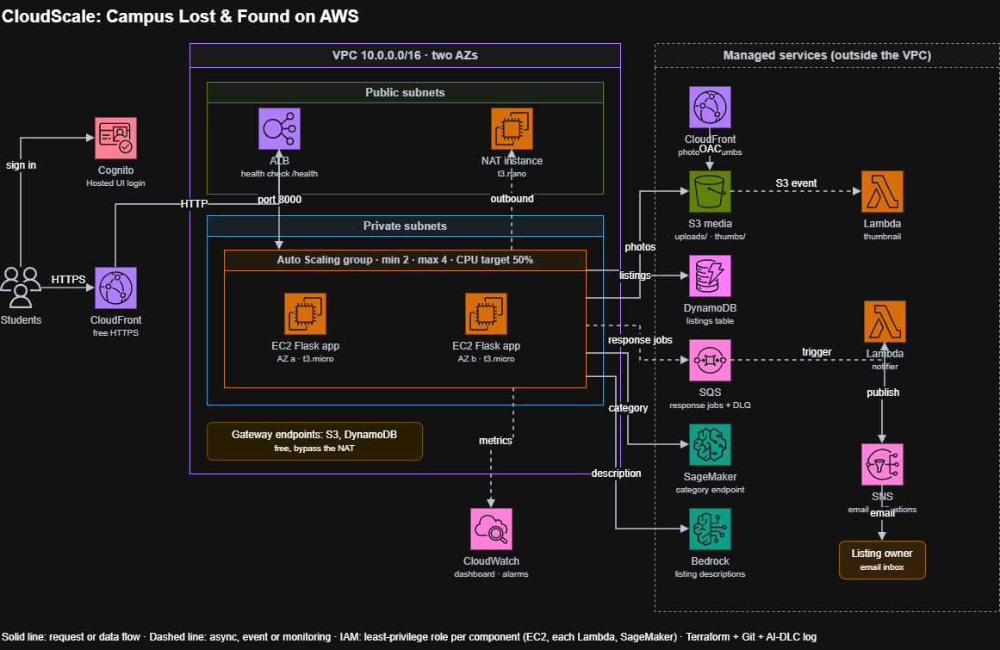

```
[ Client Browser ]
        |
        v (HTTPS:443 - CloudFront Default Cert)
[ CloudFront App Distribution ]
        |
        v (HTTP:80 via CloudFront Prefix List)
[ Application Load Balancer ] (Public Subnets, 2 AZs)
        |
        v (Port 8000)
[ EC2 Auto Scaling Group ] (2-4 t3.micro Instances in Private Subnets)
        |
        +---> [ SSM Parameter Store ] (Shared Flask session key)
        +---> [ S3 Media Bucket ] (Direct uploads/ - Private)
        |           |
        |           v (S3:ObjectCreated Event)
        |     [ Lambda #1: Thumbnail ] (Pillow Layer) ---> S3 thumbs/
        |           |
        |           v (Origin Access Control)
        |     [ CloudFront Media CDN ] (Global Image Delivery)
        |
        +---> [ DynamoDB: cloudscale-listings ] (via Private VPC Gateway Endpoint)
        |
        +---> [ SQS: cloudscale-responses ] ---> [ DLQ ]
        |           |
        |           v (Batch Size: 1)
        |     [ Lambda #2: Notifier ] ---> [ SNS Topic ] ---> [ Listing Owner Email ]
        |
        +---> [ SageMaker Serverless Endpoint ] (cloudscale-category, TF-IDF + LogisticRegression)
        |
        +---> [ Amazon Bedrock ] (amazon.nova-lite-v1:0 via Converse API)
```

### End-to-End Request Flow:
1. **Edge Ingress:** The browser connects to `https://d2oszhh0246ohl.cloudfront.net`. CloudFront terminates TLS and forwards requests over HTTP to the ALB across two public subnets.
2. **Compute Routing:** The ALB routes traffic across private `t3.micro` EC2 instances running Gunicorn/Flask. Flask retrieves its session signing secret from AWS Systems Manager Parameter Store.
3. **Cognito Authentication:** Users authenticate via Amazon Cognito Hosted UI using OAuth 2.0 authorization code flow. Flask verifies the ID token against Cognito's JWKS.
4. **Media Handling:** Image uploads go to S3 `uploads/`, triggering Lambda #1 to write 300px thumbnails to `thumbs/`. Images are served exclusively via CloudFront with Origin Access Control.
5. **NoSQL Persistence:** Listings are written to Amazon DynamoDB over a free private VPC Gateway Endpoint.
6. **Decoupled Responses:** Item responses are enqueued in Amazon SQS, consumed by Lambda #2, and emailed to the owner via Amazon SNS with message attribute filtering.
7. **AI & ML Inference:** Users click *"Suggest category"* to query the SageMaker Serverless Endpoint and *"Write description"* to invoke Amazon Bedrock Nova Lite.

---

## 3. Detailed Implementation by Phase

### Phase 1: Networking & Security Perimeter
- **Built:** Custom VPC (`10.0.0.0/16`) across 2 AZs (`us-east-1a`, `us-east-1b`) with 2 public subnets, 2 private subnets, Internet Gateway, a `t3.micro` NAT instance, and VPC Gateway Endpoints for S3 and DynamoDB.
- **Justification:** Private subnets shield application servers and databases from the public internet. Free Gateway Endpoints prevent massive S3 photo and database payloads from incurring NAT data transfer fees.
- **Configuration:** ALB security group permits port 80 only from the CloudFront origin-facing prefix list. EC2 security group accepts port 8000 only from the ALB security group.

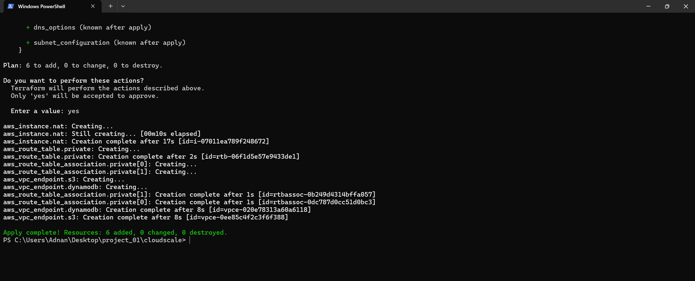

### Phase 2: Compute, Load Balancing & Auto Scaling
- **Built:** ALB with `/health` checks, CloudFront distribution providing free HTTPS without domain registration, and an EC2 Auto Scaling Group (`min 2, desired 2, max 4, t3.micro`) with CPU target-tracking at 50%.
- **Justification:** Eliminates single points of failure across availability zones and automatically responds to traffic surges.
- **Configuration:** Gunicorn (`-b 0.0.0.0:8000 -w 2`), IMDSv2 metadata tokens required, zero SSH port access (managed via SSM Session Manager).

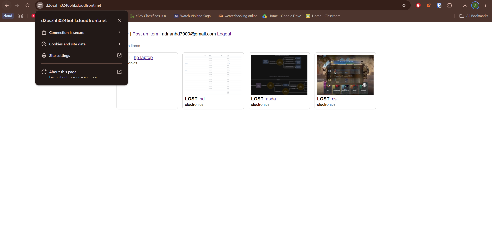

### Phase 3: Storage (S3) & CDN (CloudFront Media)
- **Built:** Private S3 bucket (`cloudscale-media-<account_id>`) with versioning enabled, lifecycle transition to Standard-IA after 30 days, expiration of noncurrent versions after 90 days, and CloudFront with Origin Access Control (OAC).
- **Justification:** Versioning guards against photo loss. Standard-IA cuts dormant photo storage costs by ~40%. OAC guarantees zero public bucket access.

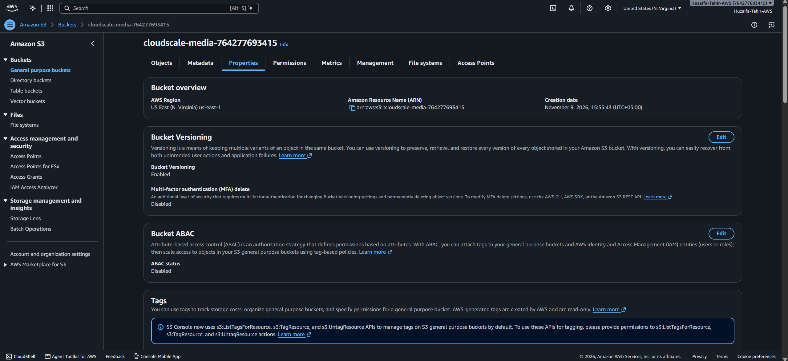

### Phase 4: Data Layer (DynamoDB NoSQL)
- **Built:** Amazon DynamoDB table (`cloudscale-listings`) with partition key `listing_id` (String) accessed through a VPC Gateway Endpoint.
- **Justification:** Lost-and-found listings require single-item lookups and dynamic schemata (responses list appended over time). On-demand billing costs $0 when idle, unlike relational databases.

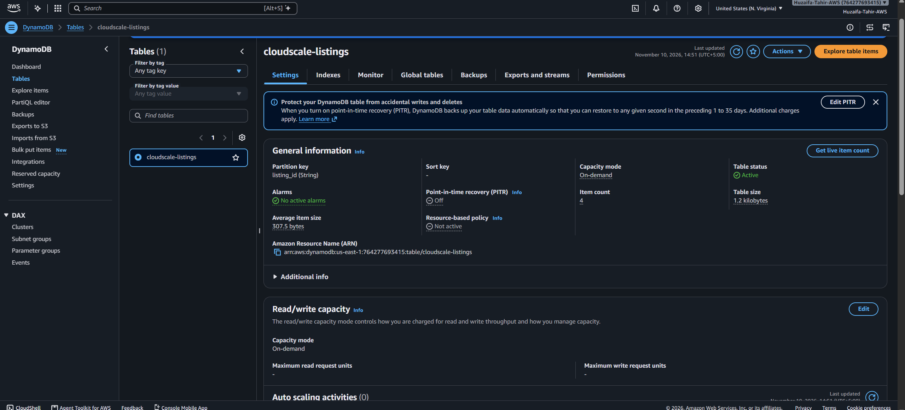

### Phase 5: Identity & Access (Amazon Cognito)
- **Built:** Cognito User Pool (`cloudscale-users`) with email sign-in, self-service verification, Hosted UI domain, and a public client utilizing authorization code grant.
- **Justification:** Secure authentication without managing user databases or password hashing on EC2. A public client eliminates storing client secrets in user-data scripts.

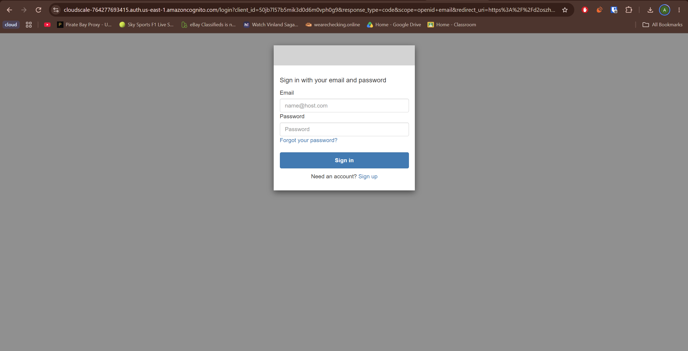

### Phase 6: Web Application Architecture (Flask)
- **Built:** Full-stack Python Flask application with Jinja2 templating, SSM-backed session management, DynamoDB integration, and S3 file uploads.
- **Justification:** Modular, lightweight micro-framework capable of horizontal scaling across instances without sticky sessions.

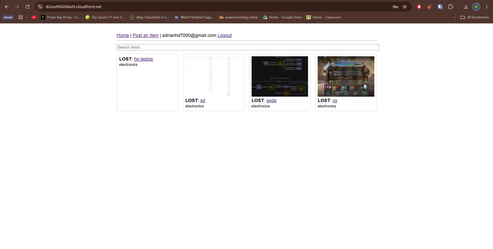

### Phase 7: Asynchronous Serverless (Lambda, SQS, SNS)
- **Built:** Lambda #1 (Thumbnail) triggered by S3 uploads writing to `thumbs/`; SQS queue with Dead-Letter Queue (DLQ); Lambda #2 (Notifier) consuming SQS and publishing to SNS email with owner filter policy.
- **Justification:** Decouples photo processing and email delivery from web responses, ensuring sub-100ms web latency. SQS retries transient delivery failures up to 3 times before DLQ.

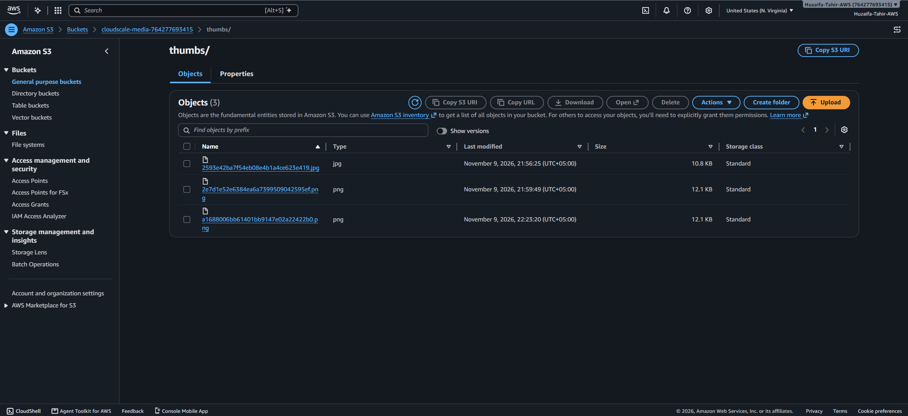

### Phase 8: Monitoring, Telemetry & Budget Controls
- **Built:** CloudWatch dashboard (`cloudscale`) tracking EC2 CPU, ALB latency/requests, and Lambda errors; CloudWatch metric alarms for high CPU (>70%) and ALB 5XX errors notifying SNS alerts email; AWS Budget ($100).
- **Justification:** Guarantees SLA observability, fast incident response, and budget overspend protection.

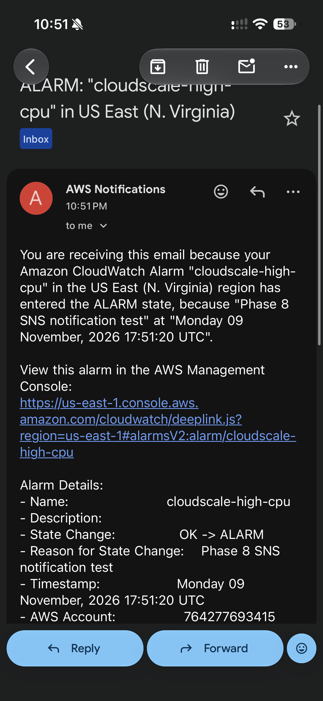

### Phase 9 & 10: AI & Machine Learning (SageMaker & Bedrock)
- **Built:** 
  1. Supervised text classifier (TF-IDF + Logistic Regression) hosted as a Serverless SageMaker endpoint (`cloudscale-category`) with in-app category suggestion button.
  2. Amazon Bedrock integration using foundation model `amazon.nova-lite-v1:0` via Bedrock Converse API for automatic description drafting.
- **Justification:** SageMaker handles predictable, narrow categorical classification using our custom dataset. Bedrock handles open-ended, contextual natural language drafting.

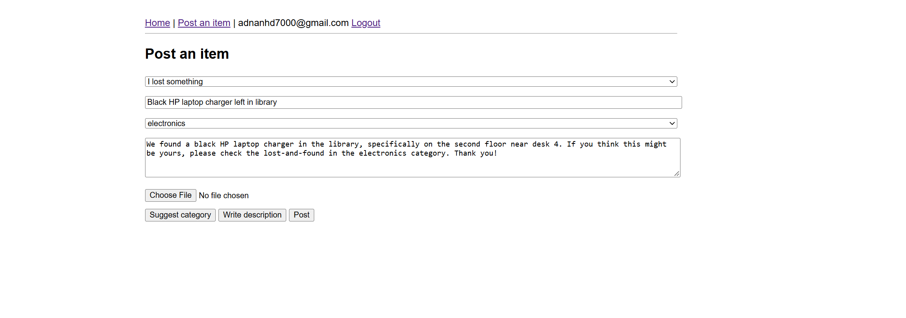

---

## 4. Automated Scaling Demonstration
- **Procedure:** Executed `python scripts/loadtest.py https://d2oszhh0246ohl.cloudfront.net/burn 600` (40 threads, 10 minutes).
- **Results:** ASG average CPU crossed 50% within 3.5 minutes. CloudWatch alarm triggered horizontal scale-out from 2 to 4 instances. Upon test completion, instances scaled in back to 2 instances.

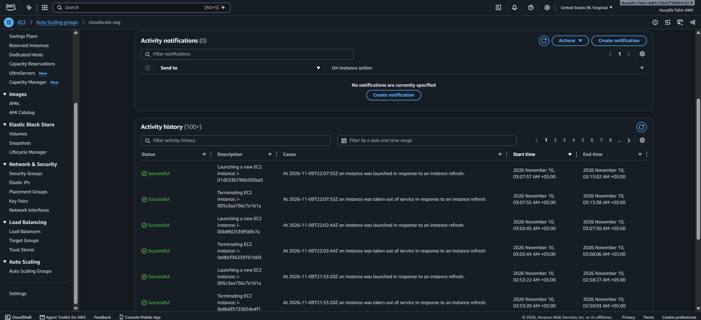

---

## 5. Resilience & Failure Recovery Demonstration
- **Procedure:** Terminated an EC2 instance forcefully via `aws ec2 terminate-instances`.
- **Results:** ALB target group drained connections and routed 100% of requests to the surviving instance with 0 downtime. ASG detected capacity deficit and launched a replacement instance within 4 minutes.


---

## 6. Cost Analysis & Architecture Trade-offs

| Decision | Alternative | Trade-off / Cost Rationale |
| :--- | :--- | :--- |
| **t3.micro NAT Instance** | AWS NAT Gateway ($32+/mo) | Saves >$30/month while providing ample bandwidth for student traffic. |
| **VPC Gateway Endpoints** | NAT Egress | Free of charge; keeps heavy S3/DynamoDB traffic entirely off the NAT. |
| **DynamoDB On-Demand** | Provisioned RDS PostgreSQL | Zero idle cost; charges purely per read/write request. |
| **Serverless SageMaker** | Real-time Instance ($40/mo) | Scales to zero instances when no inference requests are active. |
| **CloudFront Default Cert** | Route 53 Domain + ACM | Free HTTPS satisfies Cognito Hosted UI callback requirements without domain fees. |

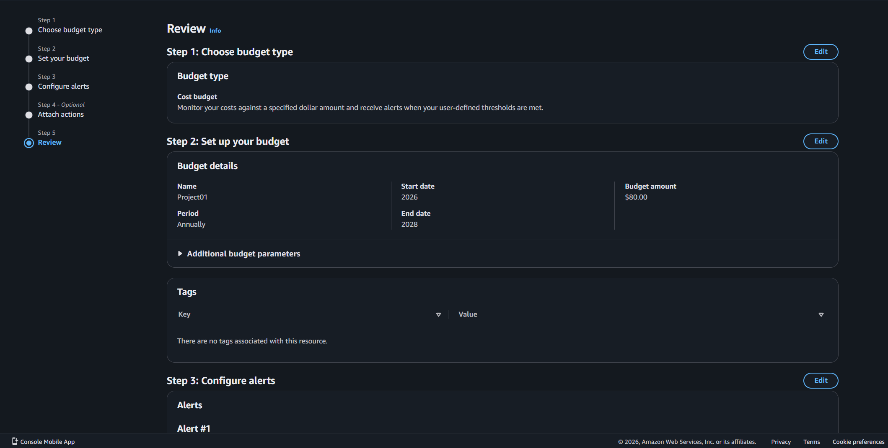

---

## 7. AI-DLC (AI-Driven Development Life Cycle) Summary

All 10 phases followed the ordered AI-DLC beats:
1. **Inception:** Prompted coding assistant with scope, constraints, and questions.
2. **Construction:** Reviewed Terraform plans and code diffs before applying; rejected insecure defaults (e.g., broad IAM `*` permissions, open SSH ports).
3. **Operations:** Verified deployed AWS resources, tested API endpoints, and committed changes with phase tags.

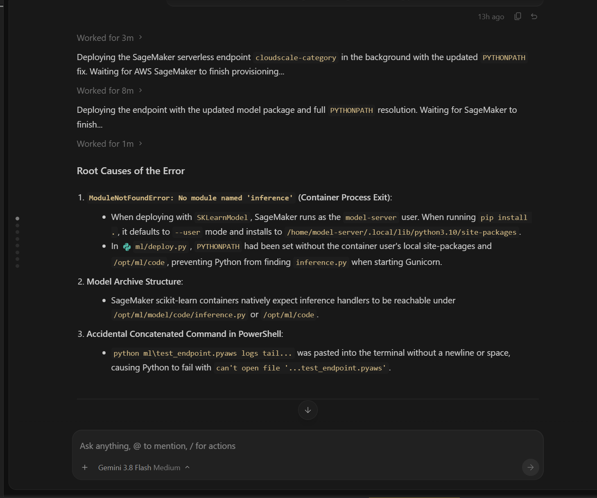

---

## 8. Limitations & Future Improvements
1. **Single NAT Instance:** Single point of failure for private egress. Future improvement: Deploy an automated failover script or multi-AZ NAT Gateway.
2. **Plain HTTP ALB Hop:** CloudFront terminates TLS, but forwards over HTTP to the ALB. Future improvement: Purchase a domain and configure end-to-end TLS.
3. **Synthetic Training Data:** Model trained on synthetic campus titles. Future improvement: Implement automated weekly retraining on accumulated real listings.
